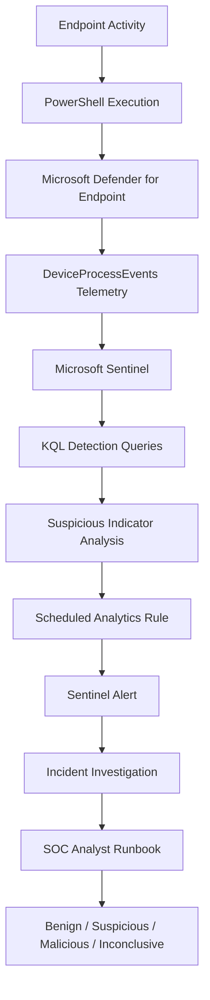

# Architecture — Suspicious PowerShell Detection

## 1. Overview

This project implements a proposed detection workflow for identifying suspicious PowerShell execution using Microsoft Defender XDR telemetry and Microsoft Sentinel.

The detection focuses on three command-line behaviors:

- Encoded PowerShell execution.
- Execution policy bypass.
- Hidden PowerShell windows.

The combined detection query identifies executions containing one or more of these indicators and provides context for further investigation.

## 2. Detection Architecture

This represents the proposed architecture. Actual data flow depends on the environment's Defender XDR and Sentinel integration.

## 3. Data Collection Layer

### Source

Microsoft Defender for Endpoint.

### Telemetry table

`DeviceProcessEvents`

This table provides process creation and execution context.

Important fields:

| Field | Purpose |
|---|---|
| Timestamp | Process event time |
| DeviceName | Endpoint involved |
| AccountName | Account executing the process |
| FileName | Executable name |
| ProcessCommandLine | Full process command line |
| InitiatingProcessFileName | Parent process name |
| InitiatingProcessCommandLine | Parent process command line |
| ProcessId | Process identifier |

The table is part of Defender XDR Advanced Hunting. Its availability in Sentinel must be confirmed.

## 4. Detection Logic Layer

The project contains individual detection queries and a combined detection query.

| Detection | Behavior |
|---|---|
| Baseline | PowerShell process execution |
| Encoded PowerShell | Encoded command-line parameters |
| Execution policy bypass | Attempts to bypass PowerShell execution policy |
| Hidden PowerShell | Hidden window execution |
| Combined detection | Correlates the three indicators within a single process event |

### Indicator evaluation

The combined query evaluates:

- `HasEncodedCommand`
- `HasExecutionPolicyBypass`
- `HasHiddenWindow`

It calculates:

`SuspiciousIndicatorCount`

This count helps prioritize investigation. It is not a calibrated risk score and does not establish malicious intent.

## 5. Alert Generation Layer

Microsoft Sentinel Scheduled Analytics Rules are proposed for operationalizing the detection.

The rule configuration includes:

- Query and lookback period.
- Query execution frequency.
- Severity.
- MITRE ATT&CK mapping.
- Entity mapping.
- Alert grouping.
- Incident creation settings.

The final configuration must be determined through testing and alert-volume analysis.

## 6. Investigation Layer

When an alert is generated, the SOC analyst reviews:

1. PowerShell command line.
2. Device and account context.
3. Parent process.
4. Related process activity.
5. Script path and script content, where available.
6. Network activity and surrounding events.
7. Whether the activity matches approved administrative behavior.

Possible outcomes:

- Benign
- Suspicious
- Malicious
- Inconclusive

Refer to `investigation/analyst-runbook.md` for the detailed workflow.

## 7. Detection Coverage and Limitations

### Covered behaviors

- Encoded PowerShell parameters.
- Execution policy bypass parameters.
- Hidden window parameters.
- Multiple suspicious indicators in a single process event.

### Current limitations

- Command-line detection does not prove malicious execution.
- Encoded commands may be legitimate administrative activity.
- This detection does not inspect decoded script content.
- It does not independently detect PowerShell script-block activity.
- It does not correlate all events across a process tree.
- Detection depends on process telemetry availability and quality.
- The current indicator logic requires additional testing for parameter syntax variations.

### Potential future enhancements

- PowerShell Script Block Logging detection.
- Correlation with network connections.
- Parent-child process behavior analysis.
- Suspicious download-and-execute patterns.
- Decoded Base64 command analysis.
- Correlation with other endpoint security alerts.

## 8. Security Engineering Considerations

The architecture follows a layered detection engineering approach:

1. Collect relevant endpoint telemetry.
2. Identify suspicious execution characteristics.
3. Preserve investigation context.
4. Validate detection behavior.
5. Analyze false positives.
6. Tune detection thresholds.
7. Operationalize through scheduled analytics rules.
8. Document investigation and response procedures.

## 9. Current Project Status

**Status: Architecture documented — operational deployment and end-to-end validation pending.**

The architecture describes the intended workflow and components. It should not be interpreted as evidence that the complete pipeline has been deployed or tested.
